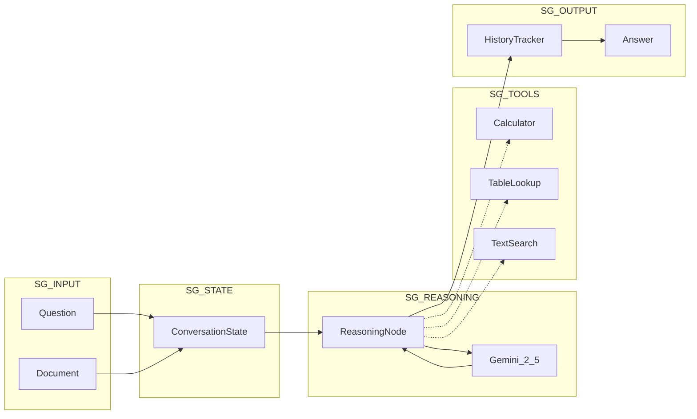

# ConvFinQA Agent

LLM-driven agentic prototype for conversational question answering on financial documents.

## Architecture



## Features

- **Multi-turn conversations** — Maintains context across question turns
- **Chain-of-thought reasoning** — Shows step-by-step analysis
- **Financial document QA** — Handles text + table extraction
- **Evaluation harness** — Measures execution accuracy

## Quick Start

### Prerequisites
- Python 3.12+
- [Poetry](https://python-poetry.org/)
- Gemini API key ([get one here](https://aistudio.google.com/app/apikey))

### Installation

```bash
poetry install
cp .env.example .env
# Add your GOOGLE_API_KEY to .env
```

### Usage

```bash
# List available records
poetry run convfinqa list-records --limit 10

# Interactive chat with a document
poetry run convfinqa chat "Single_MRO/2007/page_134.pdf-1"

# Run evaluation
poetry run convfinqa evaluate --split dev --limit 20

# Show dataset info
poetry run convfinqa info
```

## Project Structure

```
├── src/
│   ├── agents/           # LangGraph agent
│   ├── tools/            # Calculator, TableLookup, TextSearch
│   ├── core/             # Config, schemas, data loader
│   ├── evaluation/       # Metrics
│   └── cli/              # Typer CLI
├── docs/                 # Documentation
│   ├── CONTEXT.md        # Assignment brief
│   ├── CHOICES.md        # Design decisions
│   ├── implementation_plan.md
│   └── evaluation.md
├── notebooks/            # Data exploration
└── data/                 # ConvFinQA dataset
```

## Documentation

| Document | Description |
|----------|-------------|
| [CONTEXT.md](docs/CONTEXT.md) | Assignment brief and dataset overview |
| [CHOICES.md](docs/CHOICES.md) | All design decisions with rationale |
| [implementation_plan.md](docs/implementation_plan.md) | Architecture details |
| [evaluation.md](docs/evaluation.md) | Evaluation methodology and results |
| [dataset.md](dataset.md) | Original dataset card |

## Target

**≥70% execution accuracy** (beating FinQANet's 68.90%)
