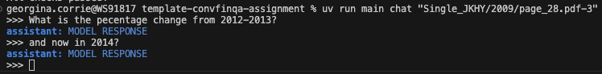
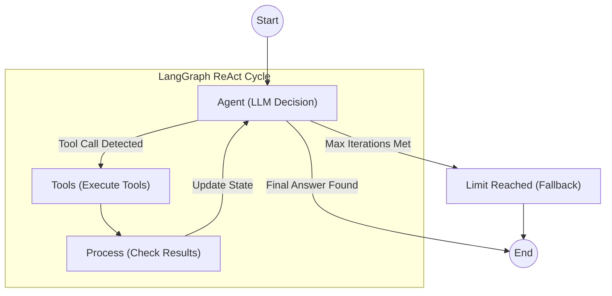

# ConvFinQA Agent: Financial Reasoning System

An agent that answers conversational financial questions by looking up table values and calculating results with deterministic tools.

**77.8% execution accuracy on a 100-conversation ConvFinQA dev subset, +8.9 pp over FinQANet (RoBERTa-large).**



[Evaluation report](REPORT.md) · [](https://github.com/sophiex59/convfinqa-agent/actions/workflows/ci.yml)

---

## Overview

The **ConvFinQA Agent** is a specialised AI system using a **Reasoning + Acting (ReAct)** architecture to:

1.  **Decompose** complex multi-hop financial questions into discrete logical steps.
2.  **Navigate** semi-structured tabular data using a coordinate-based lookup system.
3.  **Compute** answers using a deterministic Python sandbox
4.  **Audit** its own reasoning process via a persistent state machine.

---

## Technical Architecture

The system operates using **LangGraph**. This state-machine approach allows for granular control over the agent's cognitive loop, enabling planning before acting and self-correction.



### Core Components

*   **State Management (LangGraph)**: Tracks conversation history, the agent’s current reasoning steps, and tool outputs across turns.
*   **LLM (Gemini 2.5 Flash)**: Selected for its 1M+ token context window.
*   **Tool Runtime**: A secure execution environment for:
    *   `lookup_value(row, col)`: Extracts table values reliably, with fuzzy matching for varied headers.
    *   `calculate(expression)`: Performs Python arithmetic safely.
    *   `write_todos(plan)`: Enforces a structured plan before execution.

---

## Technology Stack

| Component | Technology | Rationale |
|-----------|------------|-----------|
| **Runtime** | Python 3.12+ | Modern typing, async support, and stability.|
| **Orchestration** | LangGraph | State-machine control for predictable reasoning flow and observability. |
| **Model** | Gemini 2.5 Flash | Handles large documents and supports low-latency inference. |
| **CLI** | Typer | Simple and type-safe command-line interface. |
| **Config** | Pydantic Settings | Strict environment variable and configuration management.|
| **Package Mgr** | Poetry | Reproducible dependencies and isolated environments.|
| **Container** | Docker | Ensures reproducible environments for deployment. |

---

## Project Structure

Following **Domain-Driven Design (DDD)** principles:

```text
sophiex59/
├── src/
│   ├── agents/             # Agent Logic (The "Brain")
│   │   ├── graph.py        # LangGraph definitions, state transitions
│   │   └── prompts.py      # System instructions, few-shot examples
│   ├── tools/              # Capability Layer (The "Hands")
│   │   ├── calculator.py   # Safe arithmetic execution
│   │   └── lookup.py       # Table traversal & extraction logic
│   ├── core/               # Domain Entities (The "Spine")
│   │   ├── config.py       # Pydantic environment configuration
│   │   ├── loaders.py      # PDF/JSON ingestion pipelines
│   │   └── schemas.py      # Data transfer objects (DTOs)
│   └── cli/                # Interface Layer
│       └── main.py         # Entry point for all commands
├── tests/                  # Pytest suite (Unit & Integration)
├── docs/                   # Detailed architectural documentation
├── data/                   # Dataset storage
├── Dockerfile              # Container definition
├── pyproject.toml          # Dependency manifest
└── poetry.lock             # Locked dependency tree
```

---

## Getting Started

### Prerequisites

*   **Python 3.12+**
*   **Poetry** (`pip install poetry`)
*   **Google Cloud API Key** (Access to Gemini models)

### Local Installation

1.  **Clone the Repository**
    ```bash
    git clone <repo-url>
    cd sophiex59
    ```

2.  **Install Dependencies**
    ```bash
    poetry install
    ```

3.  **Configuration**
    Create a `.env` file in the project root:
    ```env
    GOOGLE_API_KEY=AIzaSy...
    LOG_LEVEL=INFO  # Options: DEBUG, INFO, WARNING, ERROR
    ```

---

## Usage Guide

The system uses a unified CLI entry point: `convfinqa`.

### 1. Interactive Debugging (Chat Mode)
Run a specific conversation ID to inspect agent reasoning in real-time.

```bash
# Syntax: poetry run convfinqa chat <record_id>
poetry run convfinqa chat "Single_MRO/2007/page_134.pdf-1"
```

### 2. Full Evaluation Run
Execute the agent against the validation dataset (Dev Set).

```bash
# Run on 50 sampled records
poetry run convfinqa evaluate --limit 50 --json-output results.json

# Run full dev set (warning: long running)
poetry run convfinqa evaluate --split dev
```

### 3. Trace Inspection
Re-run a specific question to generate a detailed step-by-step reasoning trace.

```bash
poetry run convfinqa trace --question-id 1
```

---

## Docker Deployment

Docker ensures consistent environments across machines. Local use does not require Docker, but it is recommended for production.

1.  **Build Image**
    ```bash
    docker build -t convfinqa-agent .
    ```

2.  **Run Container**
    ```bash
    # Interactive Mode
    docker run -it --env-file .env convfinqa-agent poetry run convfinqa chat "Single_MRO/2007/page_134.pdf-1"
    
    # Evaluation Mode
    docker run --env-file .env convfinqa-agent poetry run convfinqa evaluate --limit 10
    ```

---

## Development & Testing

Code quality is enforced via `ruff`, `mypy`, and `pytest`.

### Running Tests
```bash
# Run all tests
poetry run pytest

# Run with coverage report
poetry run pytest --cov=src
```

### Code Quality
```bash
# Linting
poetry run ruff check .

# Type Checking
poetry run mypy .
```

---

## Performance Metrics

| Metric | ConvFinQA Agent (Ours) | Baseline (FinQANet) |
|:-------|:-----------------------|:--------------------|
| **Execution Accuracy** | **77.8%** | 68.9% |
| **Rejection Rate** | **10.6%** | N/A |
| **Latency (p95)** | **~5s / turn** | N/A |

**Note**: The explicit rejection rate is a safety mechanism. The agent is configured to return `N/A` rather than hallucinate an answer when data is insufficient.


## Notes:
AI was used throughout the development process. I used Antigravity with Claude Sonnet 4.5 to design the system architecture and write the code, with documentation. I used Gemini 2.5 Flash to evaluate the system.