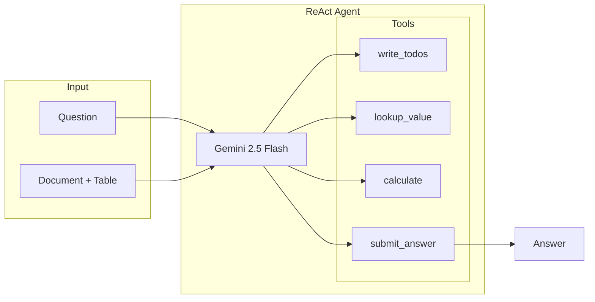

# ConvFinQA Agent

LLM-driven agentic prototype for conversational question answering on financial documents.

## Results

**76.54% accuracy** on 81 questions (20 records) — **exceeding the 70% target** and beating FinQANet baseline.

| Approach | Accuracy |
|----------|----------|
| FinQANet (paper baseline) | 68.90% |
| **ReAct Agent (ours)** | **76.54%** |

## Code Quality & Testing

Recent audits and refactoring have hardened the codebase for production:

- **Audited**: Comprehensive [codebase overview](docs/codebase_overview.md) identified key strengths (type safety, modern stack) and weaknesses (config management).
- **Refactored**: Centralized configuration in `src/core/config.py` and improved error handling.
- **Tested**: Full unit test suite for core modules (`utils`, `data_loader`, `tools`) and integration tests for the `ReAct` agent.

Run tests:
```bash
poetry run pytest
```

## Architecture



### Tool-Calling Flow

1. **write_todos** — Agent plans the approach
2. **lookup_value** — Retrieves values from table
3. **calculate** — Performs arithmetic
4. **submit_answer** — Returns final answer

## Quick Start

### Prerequisites
- Python 3.12+
- [Poetry](https://python-poetry.org/)
- Gemini API key ([get one here](https://aistudio.google.com/app/apikey))

### Installation

```bash
poetry install
cp .env.example .env
# Add your GOOGLE_API_KEY to .env
```

### Usage

```bash
# Evaluate on dev set
poetry run convfinqa evaluate --limit 10 -v

# Interactive chat
poetry run convfinqa chat "Single_MRO/2007/page_134.pdf-1"

# Trace tool calls for one question
poetry run convfinqa trace -q 1

# List records
poetry run convfinqa list-records

# Dataset info
poetry run convfinqa info
```

## Project Structure

```
├── src/
│   ├── agents/           # ReAct agent with LangGraph
│   ├── tools/            # write_todos, lookup_value, calculate, submit_answer
│   ├── core/             # Config, schemas, data loader
│   └── cli/              # Typer CLI
├── docs/                 # Documentation
│   ├── CONTEXT.md        # Assignment brief
│   ├── CHOICES.md        # Design decisions
│   └── evaluation.md     # Evaluation methodology and results
└── data/                 # ConvFinQA dataset
```

## Documentation

| Document | Description |
|----------|-------------|
| [CONTEXT.md](docs/CONTEXT.md) | Assignment brief and dataset overview |
| [CHOICES.md](docs/CHOICES.md) | All design decisions with rationale |
| [evaluation.md](docs/evaluation.md) | Evaluation methodology and results |
