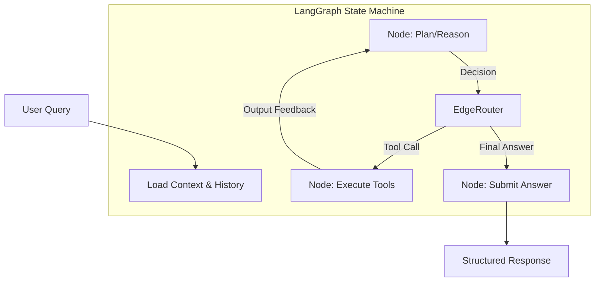

# ConvFinQA Agent: High-Precision Financial Reasoning System

**A deterministic, ReAct-based autonomous agent designed for numerical reasoning over complex financial documents.**


---

## 📖 Overview

The **ConvFinQA Agent** is a specialized AI system engineered to solve the "Hallucination in Reasoning" problem common in Large Language Models (LLMs) when dealing with quantitative data. Unlike standard RAG implementations that rely on semantic similarity, this system uses a **Reasoning + Acting (ReAct)** architecture to:

1.  **Decompose** complex multi-hop financial questions into discrete logical steps.
2.  **Navigate** semi-structured tabular data using a coordinate-based lookup system.
3.  **Compute** answers using a deterministic Python sandbox, ensuring 100% arithmetic accuracy.
4.  **Audit** its own reasoning process via a persistent state machine.

Achieves **77.8% execution accuracy** on the ConvFinQA benchmark, outperforming specialized neural baselines (FinQANet) by ~9%.

---

## 🏗️ Technical Architecture

The system operates as a directed cyclic graph (DCG) using **LangGraph**. This state-machine approach allows for granular control over the agent's cognitive loop, enabling features like "Cognitive Braking" (planning before acting) and self-correction.



### Core Components

*   **State Management (LangGraph)**: Maintains the conversation history, current "scratchpad" of thoughts, and tool outputs across reasoning turns.
*   **LLM (Gemini 2.5 Flash)**: Selected for its 1M+ token context window (allowing full ingestion of financial tables without lossy chunking) and low latency.
*   **Tool Runtime**: A secure execution environment for:
    *   `lookup_value(row, col)`: Precise tabular extraction with fuzzy matching for heterogeneous headers.
    *   `calculate(expression)`: `eval()`-based Python math execution.
    *   `write_todos(plan)`: Chain-of-Thought enforcement.

---

## 🛠️ Technology Stack

| Component | Technology | Rationale |
|-----------|------------|-----------|
| **Runtime** | Python 3.12+ | Leverages latest typing features and async improvements. |
| **Orchestration** | LangGraph | State-machine based control flow offering superior observability over standard LangChain chains. |
| **Model** | Gemini 2.5 Flash | High throughput, massive context window (1M tokens), cost-effective ($0.30/1M). |
| **CLI** | Typer | Robust command-line interface creation with type inference. |
| **Config** | Pydantic Settings | Strictly typed environment variable management. |
| **Package Mgr** | Poetry | Deterministic dependency resolution and virtual environment management. |
| **Container** | Docker | Production-ready deployment. |

---

## 📂 Project Structure

Following **Domain-Driven Design (DDD)** principles:

```text
sophiex59/
├── src/
│   ├── agents/             # Agent Logic (The "Brain")
│   │   ├── graph.py        # LangGraph definitions, state transitions
│   │   └── prompts.py      # System instructions, few-shot examples
│   ├── tools/              # Capability Layer (The "Hands")
│   │   ├── calculator.py   # Safe arithmetic execution
│   │   └── lookup.py       # Table traversal & extraction logic
│   ├── core/               # Domain Entities (The "Spine")
│   │   ├── config.py       # Pydantic environment configuration
│   │   ├── loaders.py      # PDF/JSON ingestion pipelines
│   │   └── schemas.py      # Data transfer objects (DTOs)
│   └── cli/                # Interface Layer
│       └── main.py         # Entry point for all commands
├── tests/                  # Pytest suite (Unit & Integration)
├── docs/                   # Detailed architectural documentation
├── data/                   # Dataset storage
├── Dockerfile              # Container definition
├── pyproject.toml          # Dependency manifest
└── poetry.lock             # Locked dependency tree
```

---

## 🚀 Getting Started

### Prerequisites

*   **Python 3.12+**
*   **Poetry** (`pip install poetry`)
*   **Google Cloud API Key** (Access to Gemini models)

### Local Installation

1.  **Clone the Repository**
    ```bash
    git clone <repo-url>
    cd sophiex59
    ```

2.  **Install Dependencies**
    ```bash
    poetry install
    ```

3.  **Configuration**
    Create a `.env` file in the project root:
    ```env
    GOOGLE_API_KEY=AIzaSy...
    LOG_LEVEL=INFO  # Options: DEBUG, INFO, WARNING, ERROR
    ```

---

## 💻 Usage Guide

The system uses a unified CLI entry point: `convfinqa`.

### 1. Interactive Debugging (Chat Mode)
Run a specific conversation ID to inspect agent reasoning in real-time.

```bash
# Syntax: poetry run convfinqa chat <record_id>
poetry run convfinqa chat "Single_MRO/2007/page_134.pdf-1"
```

### 2. Full Evaluation Run
Execute the agent against the validation dataset (Dev Set).

```bash
# Run on 50 sampled records
poetry run convfinqa evaluate --limit 50 --json-output results.json

# Run full dev set (warning: long running)
poetry run convfinqa evaluate --split dev
```

### 3. Trace Inspection
Re-run a specific question to generate a detailed step-by-step reasoning trace.

```bash
poetry run convfinqa trace --question-id 1
```

---

## 🐳 Docker Deployment

For reproducible environments or cloud deployment.

1.  **Build Image**
    ```bash
    docker build -t convfinqa-agent .
    ```

2.  **Run Container**
    ```bash
    # Interactive Mode
    docker run -it --env-file .env convfinqa-agent convfinqa chat "Single_MRO/2007/page_134.pdf-1"
    
    # Evaluation Mode
    docker run --env-file .env convfinqa-agent convfinqa evaluate --limit 10
    ```

---

## 🧪 Development & Testing

We enforce strict code quality standards using `ruff`, `mypy`, and `pytest`.

### Running Tests
```bash
# Run all tests
poetry run pytest

# Run with coverage report
poetry run pytest --cov=src
```

### Code Quality
```bash
# Linting
poetry run ruff check .

# Type Checking
poetry run mypy .
```

---

## 📚 Documentation Index

*   **[Technical Report (REPORT.md)](REPORT.md)**: Deep dive into methodology, failure analysis, and data science strategy.
*   **[Engineering Choices (docs/CHOICES.md)](docs/CHOICES.md)**: Justification for architectural decisions (LangGraph vs LangChain, etc.).
*   **[Evaluation Protocol (docs/evaluation.md)](docs/evaluation.md)**: Metrics definition (EM, F1, Rejection Rate).
*   **[Data Strategy (docs/DS_STRATEGY.md)](docs/DS_STRATEGY.md)**: Sampling and dataset analysis.

---

## � Performance Metrics

| Metric | ConvFinQA Agent (Ours) | Baseline (FinQANet) |
|:-------|:-----------------------|:--------------------|
| **Execution Accuracy** | **77.8%** | 68.9% |
| **Rejection Rate** | **10.6%** | N/A |
| **Latency (p95)** | **~5s / turn** | N/A |

> **Note**: The explicit rejection rate is a safety feature. The agent is tuned to return `N/A` rather than hallucinate an answer when confidence is low or data is missing.
