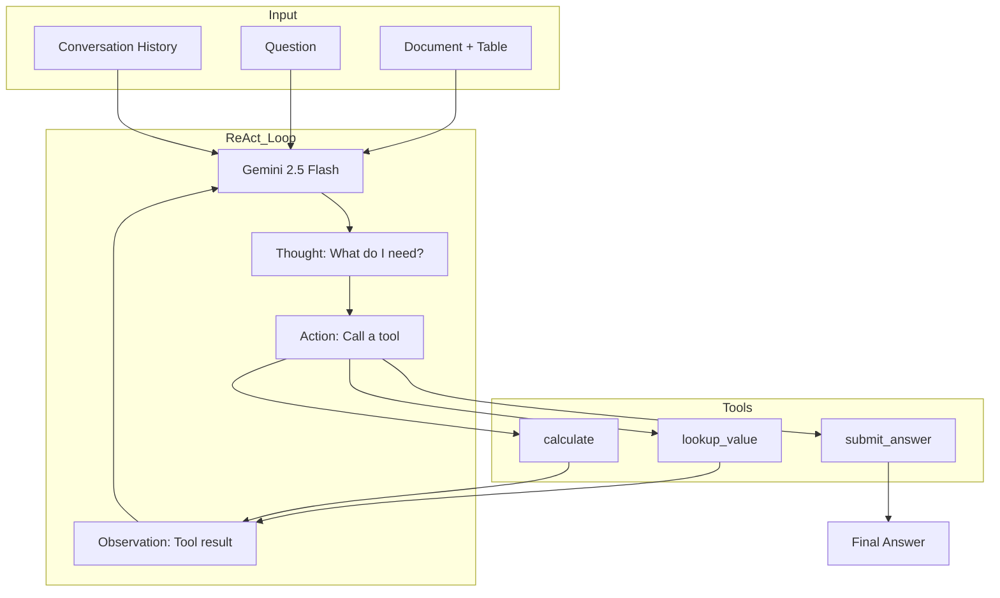

# Implementation Plan v3: Tool-Calling Agent

> **Senior Engineer Review**: After achieving 69% with pure prompting, I've analyzed our error patterns and reconsidered the tool-calling approach. This document reflects a pragmatic, evidence-based design.

---

## Current State

| Metric | Value |
|--------|-------|
| Accuracy (Phase 1) | 27% |
| Accuracy (Phase 2) | **69%** |
| Target | ≥70% (FinQANet baseline: 68.9%) |
| Human Expert | 89.44% |

**We've already matched the FinQANet baseline.** The question is: can tools push us higher?

---

## Error Analysis (from 69% run)

| Error Type | Count | Root Cause | Tool Solution |
|------------|-------|------------|---------------|
| "I don't know" | 5 | Model gives up | Forced tool completion |
| Sign errors | 4 | Extraction confusion | Explicit lookup tool |
| Ratio inversion | 3 | Wrong division order | Planning step |
| Format leaking | 3 | "2.2 billion" | Format normalization |
| Wrong value | 6 | Table parsing | Explicit lookup tool |
| Calculation errors | 4 | Arithmetic mistakes | Calculator tool |

**Key insight**: Most errors are about **value extraction**, not calculation. The LLM is good at math but sometimes picks the wrong cell.

---

## Tool Design Philosophy

### What Tools Should Do

1. **Force structure** — Agent must plan before answering
2. **Verify extraction** — Explicit lookups return confirmed values
3. **Guarantee arithmetic** — No mental math errors
4. **Standardize output** — Consistent answer format

### What Tools Should NOT Do

1. **Slow down simple questions** — Direct lookups shouldn't need 5 tool calls
2. **Add unnecessary complexity** — Tools should be simple and composable
3. **Replace LLM reasoning** — LLM still does the thinking

---

## Proposed Tool Set

### Tool 1: `lookup_value`

**Purpose**: Explicit, verified table value extraction.

```python
@tool
def lookup_value(row: str, column: str) -> str:
    """
    Look up a specific value from the financial table.
    
    Args:
        row: Row identifier (e.g., "2007", "total revenue")
        column: Column identifier (e.g., "revenue", "Q1")
    
    Returns:
        The value at that cell, or error if not found.
    
    Example:
        lookup_value("2007", "weighted average exercise price") → "60.94"
    """
```

**Why**: The table is already in context, but explicit lookups force the agent to be specific. Returns the exact value, preventing "I saw 2006 when they asked for 2007" errors.

### Tool 2: `calculate`

**Purpose**: Verified arithmetic operations.

```python
@tool  
def calculate(expression: str) -> float:
    """
    Evaluate a mathematical expression safely.
    
    Args:
        expression: Math expression using values from lookups.
                   Supports: +, -, *, /, parentheses
    
    Returns:
        The computed result.
    
    Examples:
        calculate("60.94 - 25.14") → 35.8
        calculate("(60.94 - 25.14) / 25.14") → 1.42403
    """
```

**Why**: We already have this. LLM is good at arithmetic but explicit calculation provides a paper trail and catches edge cases.

### Tool 3: `submit_answer`

**Purpose**: Final answer submission with format specification.

```python
@tool
def submit_answer(value: Union[float, str], format: str = "number") -> None:
    """
    Submit the final answer. THIS IS THE ONLY WAY TO COMPLETE.
    
    Args:
        value: The answer value
        format: One of "number", "percentage", "yes", "no"
                - "number": Return as-is (e.g., 35.8)
                - "percentage": Return as decimal (e.g., 0.14 not 14%)
                - "yes"/"no": Boolean response
    
    Note:
        You MUST call this tool to finish. Cannot respond directly.
    """
```

**Why**: Forces consistent output format. Handles the "142.4% vs 0.14" problem. Prevents "I don't know" by requiring explicit submission.

---

## Removed from Original Plan

| Proposed Tool | Decision | Reasoning |
|--------------|----------|-----------|
| `write_todos` | ❌ Removed | Overhead. CoT in prompt already plans. Can add if needed. |
| `normalize_answer` | ❌ Merged | Combined into `submit_answer` for simplicity. |

**Principle**: Start minimal. Add tools if errors suggest they're needed.

---

## Agent Architecture



---

## Agent Prompt

```markdown
You are a financial document analyst. You have access to tools to help you answer questions.

## Available Tools
- lookup_value(row, column): Get a specific value from the table
- calculate(expression): Perform arithmetic
- submit_answer(value, format): Submit your final answer (REQUIRED)

## Rules
1. Use lookup_value to extract specific values - don't guess from the table
2. Use calculate for any arithmetic - do not compute mentally
3. format can be: "number", "percentage", "yes", "no"
4. For percentages, submit as decimal (0.14 not 14%)
5. You MUST call submit_answer to complete - this is the only way to finish

## Document
{document_context}

## Conversation History  
{conversation_history}

## Current Question
{question}

Think step by step, use tools to verify your work, then submit your answer.
```

---

## Implementation Plan

### Phase 3A: Tool Binding (Est: 1 hour)

```
src/tools/
├── agent_tools.py      # NEW: LangChain-compatible tool definitions
│   ├── lookup_value()  # Uses existing table_lookup logic
│   ├── calculate()     # Uses existing calculator logic
│   └── submit_answer() # New: final answer with format
```

**Tasks:**
- [ ] Create `agent_tools.py` with `@tool` decorated functions
- [ ] Bind to existing implementations
- [ ] Add Pydantic schemas for tool inputs

### Phase 3B: ReAct Agent (Est: 1 hour)

```
src/agents/
├── react_agent.py      # NEW: ReAct agent using LangGraph
├── graph.py            # UPDATE: Add react agent option
```

**Tasks:**
- [ ] Create ReAct agent using `create_react_agent`
- [ ] Configure tool execution loop
- [ ] Add max iterations (prevent infinite loops)
- [ ] Handle submit_answer as termination signal

### Phase 3C: Integration (Est: 30 min)

**Tasks:**
- [ ] Add `--agent-type` flag to CLI (chain vs react)
- [ ] Update async evaluation to use react agent
- [ ] Test on 10 records

### Phase 3D: Evaluation (Est: 30 min)

**Tasks:**
- [ ] Run full dev set evaluation
- [ ] Compare chain vs react accuracy
- [ ] Analyze tool usage patterns
- [ ] Document findings

---

## Success Criteria

| Metric | Target |
|--------|--------|
| Execution Accuracy | ≥75% (improvement over 69%) |
| "I don't know" rate | 0% (forced completion) |
| Tool call overhead | <2x latency increase |

---

## Fallback Plan

If tool-calling doesn't improve accuracy:
1. Document what we learned
2. Keep the simpler chain approach (69% is already good)
3. Focus on few-shot examples instead

**Principle**: "Complexity ≠ sophistication". Only add complexity when it demonstrably helps.

---

## Next Steps

1. ✅ Review complete - proceeding with implementation
2. → Create `agent_tools.py` with three tools
3. → Create ReAct agent
4. → Test and evaluate
5. → Write REPORT.md
