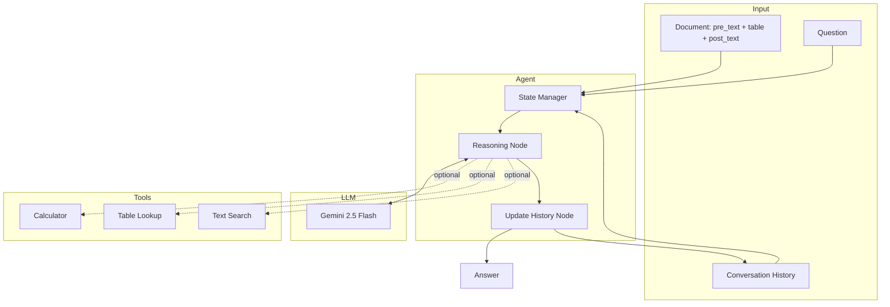

# Implementation Plan

## Problem Statement

Build an agentic prototype that answers conversational dialogue questions on financial documents using the ConvFinQA dataset.

**Key challenges**:
1. Multi-hop numerical reasoning (chained calculations)
2. Table + text understanding
3. Conversation context (references to previous answers)
4. Format variations in answers

---

## Solution Architecture



---

## Approach Options

### Option A: Pure LLM (Minimal Tooling) ✅ Current Implementation

The LLM handles everything: table parsing, calculations, and reasoning.

```
Prompt → LLM → Chain-of-thought reasoning → Answer
```

**Pros**:
- Simple architecture
- Modern LLMs are strong at arithmetic
- Fewer failure points

**Cons**:
- Less control over calculations
- Harder to debug specific failures

**When to use**: MVP, rapid prototyping, strong base model

### Option B: Tool-Augmented Agent ⚠️ Available but Optional

LLM decides when to call explicit tools for calculations and lookups.

```
Prompt → LLM → [Tool Call?] → Tool Result → LLM → Answer
```

**Pros**:
- Verifiable calculations
- Explicit table lookups
- Better debugging

**Cons**:
- Tool call overhead
- Potential for tool misuse

**When to use**: When calculation accuracy is critical

### Option C: DSL Generation ❌ Not Implemented (Future)

LLM generates a domain-specific language program, which is then executed.

```
Prompt → LLM → DSL Program → Executor → Answer
```

**Pros**:
- Fully verifiable
- Matches paper's approach
- Can compare program accuracy

**Cons**:
- Complex to implement
- Requires DSL parser

**When to use**: Research, maximum accuracy

---

## Prompting Strategies

### Strategy 1: Chain-of-Thought ✅ Implemented

```
You are a financial document analyst.

[Document Context]

[Conversation History]

Question: {question}

Think step by step:
1. Identify what information you need
2. Extract values from the document
3. Perform any calculations
4. Format your answer

REASONING:
[Your analysis]

ANSWER:
[Final answer]
```

### Strategy 2: Few-Shot Examples ⚠️ Future Enhancement

Add 2-3 examples before the current question to demonstrate expected format.

```
Example 1:
Q: What was revenue in 2019?
A: Looking at the table, revenue for 2019 is $1.5M
ANSWER: 1.5 million

Example 2:
Q: What was the change from 2018?
A: Revenue 2019 was $1.5M, 2018 was $1.2M. Change = 1.5 - 1.2 = 0.3M
ANSWER: 0.3 million

Now answer:
Q: {current_question}
```

### Strategy 3: Structured Output ⚠️ Future Enhancement

Force JSON output for easier parsing.

```python
class Answer(BaseModel):
    reasoning: str
    calculation: Optional[str]
    answer: str
    confidence: float

llm.with_structured_output(Answer)
```

---

## Component Details

### 1. State Management

```python
class ConversationState(BaseModel):
    # Document context
    record_id: str
    pre_text: str
    post_text: str
    table: dict
    
    # Conversation
    messages: list[Message]
    current_question: str
    current_answer: str
    reasoning_trace: str
    
    # History
    turn_index: int
    answers_history: list[str]
```

### 2. Tools

| Tool | Function | Input | Output |
|------|----------|-------|--------|
| `calculate` | Safe math eval | `"60.94 - 25.14"` | `35.8` |
| `lookup_table` | Extract table value | `(table, "2007", "revenue")` | `1234567` |
| `search_text` | Find text snippets | `(text, "total employees")` | `["...12,500 employees..."]` |
| `percent_change` | Calculate % change | `(old, new)` | `0.25` |

### 3. LLM Configuration

| Parameter | Value | Rationale |
|-----------|-------|-----------|
| Model | `gemini-2.5-flash` | Best cost/performance |
| Temperature | `0` | Deterministic for evaluation |
| Context | Full document + history | Within context limits |

---

## Implementation Phases

### Phase 1: MVP ✅ Complete
- [x] LangGraph agent structure
- [x] Basic chain-of-thought prompting
- [x] State management
- [x] CLI interface

### Phase 2: Tools & Evaluation ✅ Complete
- [x] Calculator tool
- [x] Table lookup tool
- [x] Text search tool
- [x] Evaluation harness

### Phase 3: Optimization (Current)
- [ ] Numeric answer normalization
- [ ] Error categorization
- [ ] Results analysis
- [ ] REPORT.md

### Phase 4: Enhancements (Future)
- [ ] Few-shot examples
- [ ] Structured output
- [ ] Program accuracy metric
- [ ] DSL generation

---

## File Structure

```
src/
├── agents/
│   ├── graph.py          # LangGraph conversation graph
│   ├── nodes.py          # Reasoning and update nodes
│   └── state.py          # ConversationState schema
├── tools/
│   ├── calculator.py     # Safe math evaluation
│   ├── table_lookup.py   # Table value extraction
│   └── text_search.py    # Text search utilities
├── core/
│   ├── config.py         # Settings (API key, model)
│   ├── schemas.py        # Pydantic models for dataset
│   └── data_loader.py    # Dataset loading
├── evaluation/
│   └── metrics.py        # Accuracy calculations (TODO)
└── cli/
    └── main.py           # Typer CLI app
```

---

## Next Steps

1. **Run full evaluation** on dev set with rate limit removed
2. **Implement proper numeric comparison** in evaluation
3. **Analyze errors** by category
4. **Write REPORT.md** with findings
5. **Create PR** to main branch
