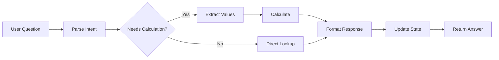

# ConvFinQA Agent Architecture

## Assignment Context

Build an LLM-driven prototype that answers **conversational dialogue questions** on financial documents using the ConvFinQA dataset (~3,458 records, ~14K questions). Key requirements:
- Multi-hop numerical reasoning over text + tables
- Demonstrate knowledge of modern LLM techniques (not just replicating the paper)
- Clean code structure + report on method/findings

---

## Existing Repository Analysis

| File | Status | Rationale |
|------|--------|-----------|
| `data/convfinqa_dataset.json` | ✅ Keep | Core dataset (3,037 train / 421 dev records) |
| `dataset.md` | ✅ Keep | Excellent schema documentation |
| `pyproject.toml` (UV/hatch) | ❌ Replace | Switching to Poetry for better Docker/CI integration |
| `src/main.py`, `logger.py` | ❌ Replace | Minimal boilerplate, fresh agent architecture needed |

### Why Poetry over UV?

| Aspect | Poetry | UV |
|--------|--------|-----|
| Docker integration | Excellent (`poetry install --no-root`) | Newer, less documented |
| Lock file reliability | Battle-tested | Newer format |
| IDE support | Excellent (PyCharm, VSCode) | Growing |
| CI/CD examples | Abundant | Fewer |
| Speed | Slower | ⚡ Much faster |

**Decision**: Poetry — we prioritize ecosystem maturity and Docker integration over raw speed for this project.

---

## Architectural Decisions

### 1. Agent Framework: LangGraph ✅

**Options Explored:**

| Framework | Pros | Cons |
|-----------|------|------|
| **LangGraph** | Graph-based flow control, state management, checkpointing | Steeper learning curve, LangChain ecosystem |
| AutoGen | Multi-agent conversations | Overkill for structured QA |
| CrewAI | Simple role metaphor | Less control over execution |
| Custom | Full control | High development effort |

**Decision**: LangGraph — Even for a simple system, the graph-based approach provides:
- Clear visualization of conversation flow
- Built-in state management for multi-turn dialogue
- Easy to extend later without refactoring

### 2. Document Processing: Direct LLM Ingestion ✅

**Analysis of ConvFinQA documents:**
```
Total records: 3,458
Document sizes (including table):
  Min: 499 chars → ~125 tokens
  Max: 14,886 chars → ~3,700 tokens
  Avg: 4,177 chars → ~1,000 tokens
```

**Decision**: No PDF parsing needed. Documents are pre-extracted JSON with text + tables. Gemini 2.5's 1M+ token context handles these trivially.

### 3. LLM Provider: Gemini 2.5 ✅

| Provider | Context | Strengths |
|----------|---------|-----------|
| **Gemini 2.5** | 1M+ tokens | Native multimodal, excellent reasoning, cost-effective |
| OpenAI GPT-4o | 128K tokens | Strong function calling |
| Claude 3.5 | 200K tokens | Great reasoning |

**Decision**: Gemini 2.5 — Massive context window (future-proofs for larger docs), strong structured output, good cost/performance ratio.

### 4. Container Strategy: Single Container ✅

```dockerfile
FROM python:3.12-slim
# All components in one image for MVP
```

**Decision**: Start simple. If agents need async execution later, we can add worker containers.

### 5. Project Structure: Modular Monolith ✅

```
financial_document_parser/
├── pyproject.toml              # Poetry config
├── Dockerfile
├── docker-compose.yml
├── .env.example
├── src/
│   ├── agents/                 # LangGraph agent definitions
│   │   ├── graph.py            # Main conversation graph
│   │   ├── nodes.py            # Individual agent nodes
│   │   └── state.py            # Conversation state schema
│   ├── tools/                  # Agent tools
│   │   ├── calculator.py       # Numerical operations
│   │   ├── table_lookup.py     # Table data extraction
│   │   └── retriever.py        # Document retrieval
│   ├── core/                   # Core logic
│   │   ├── llm.py              # Gemini client
│   │   ├── schemas.py          # Pydantic models
│   │   └── config.py           # Settings management
│   ├── evaluation/             # Metrics & evaluation
│   │   └── metrics.py          # Accuracy calculations
│   └── cli/                    # CLI interface
│       └── main.py             # Typer app
├── tests/
├── data/                       # Symlink or copy from existing
└── notebooks/                  # Exploration
```

### 6. Agent Tools

The agent will need tools to handle multi-hop numerical reasoning:

| Tool | Purpose | Example Use |
|------|---------|-------------|
| `calculate` | Execute arithmetic operations | `calculate("156.2 - 143.1")` → `13.1` |
| `lookup_table` | Extract values from document table | `lookup_table("revenue", "2019")` → `1,234,567` |
| `lookup_text` | Find facts in pre/post text | `lookup_text("total employees")` → `"12,500"` |
| `compare` | Compare two values | `compare(100, 80, "percent_change")` → `25%` |
| `format_answer` | Format final response | `format_answer(0.25, "percent")` → `"25%"` |

### 7. Conversation & Evaluation Strategy

**Conversation Flow:**


**Evaluation Metrics:**
- **Execution Accuracy (Exe Acc)** — Primary metric from paper (does computed answer match gold?)
- **Program Accuracy** — Does reasoning chain match expected DSL?
- **Turn-level Accuracy** — Accuracy per conversation turn

**Baseline Targets:**
| Baseline | Exe Acc | Our Target |
|----------|---------|------------|
| Human Expert | 89.44% | — |
| FinQANet (best) | 68.90% | ≥70% |
| GPT-3 CoT | 40.63% | >> this |

---

## Remaining Decisions (Updated)

### ✅ Conversation mode: Multi-turn
Support interactive multi-turn conversations, maintaining context across question turns.

### ✅ Error handling: Show reasoning trace + Log for analysis

**Approach**: Display step-by-step reasoning for debugging. When errors occur, log them for offline analysis to improve prompting/agent design.

```
Agent Response → Validate → Log result (success/failure with trace) → Return
```

No automatic retry/self-correction in initial implementation — we'll analyze errors externally rather than adding complexity. Can add self-correction later if patterns emerge.

### ✅ Report format: Markdown
Use `REPORT.md` for the final write-up.

### ✅ Evaluation strategy: Sample + test holdout

**Dataset split**:
| Split | Records | Usage |
|-------|---------|-------|
| Train | 3,037 | Few-shot examples, fine-tuning |
| Dev | 421 | Iteration & hyperparameter tuning |
| Test | 434 | Final evaluation (not in our JSON, but from paper) |

> [!NOTE]
> The provided JSON has train + dev. The paper mentions a test set of 434 records (held out for blind evaluation). For now, we'll sample from dev for fast iteration.

---

## Next Steps

1. ✅ Architecture decisions finalized
2. → Set up Poetry + Docker infrastructure
3. → Implement core agent with LangGraph
4. → Add tools (calculator, table lookup)
5. → Build evaluation harness
6. → Run experiments & write report
